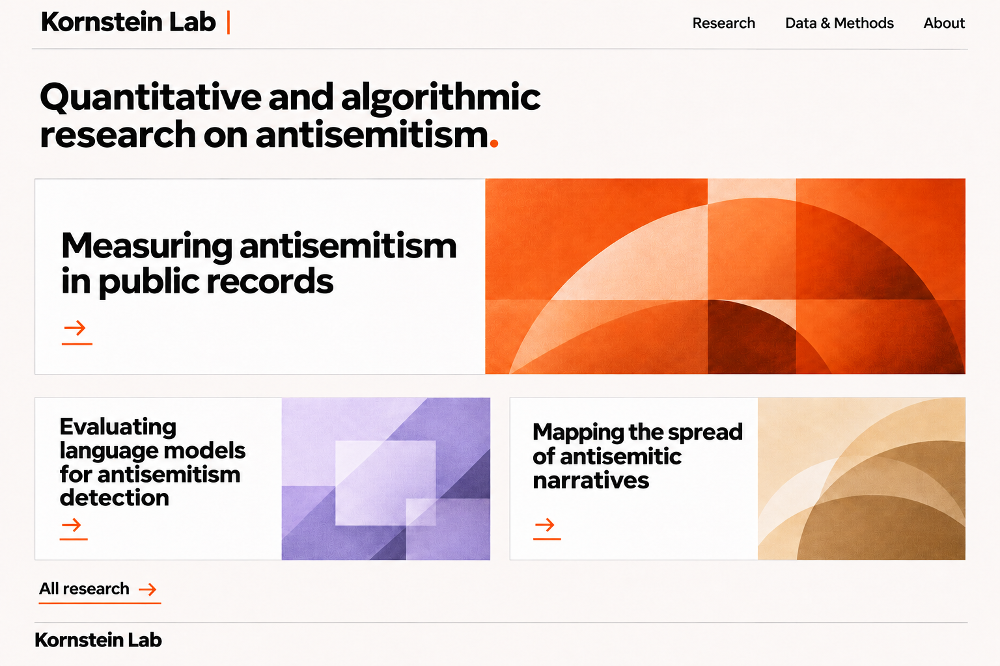
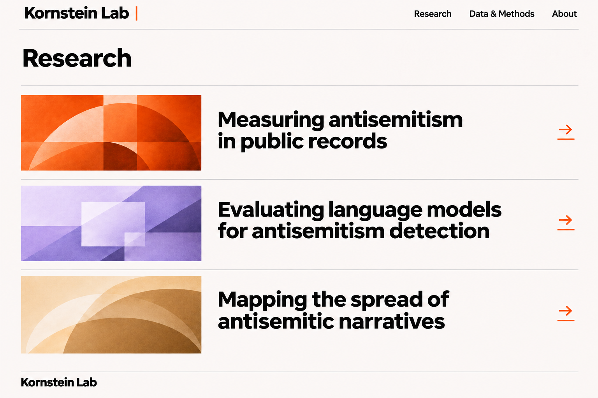
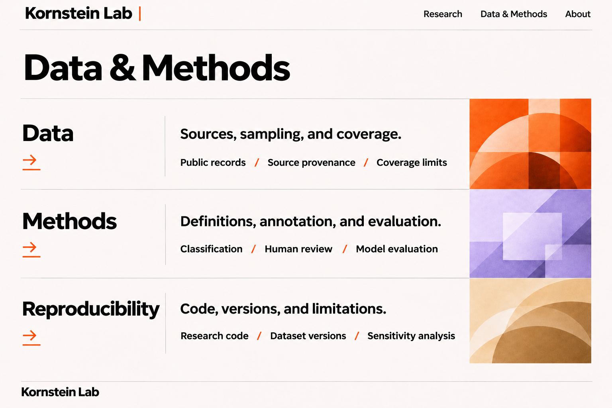
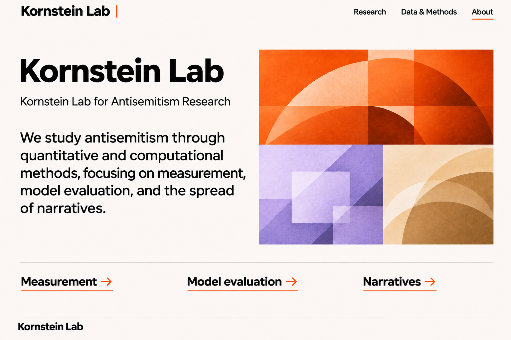
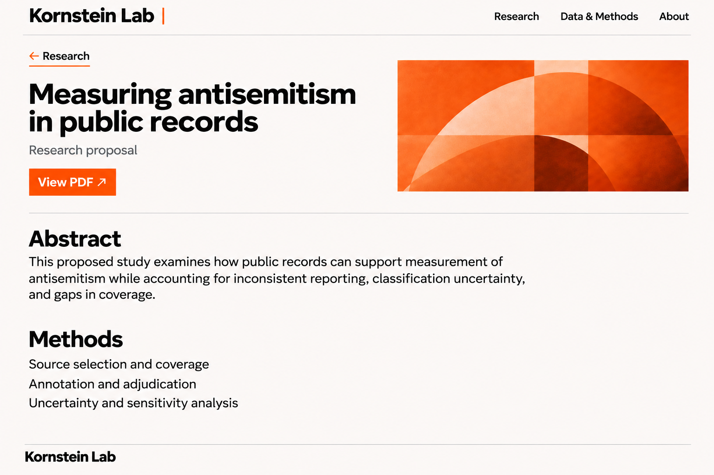
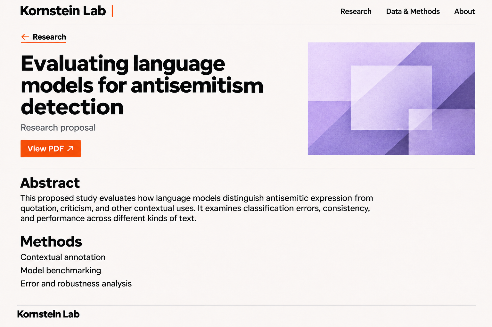
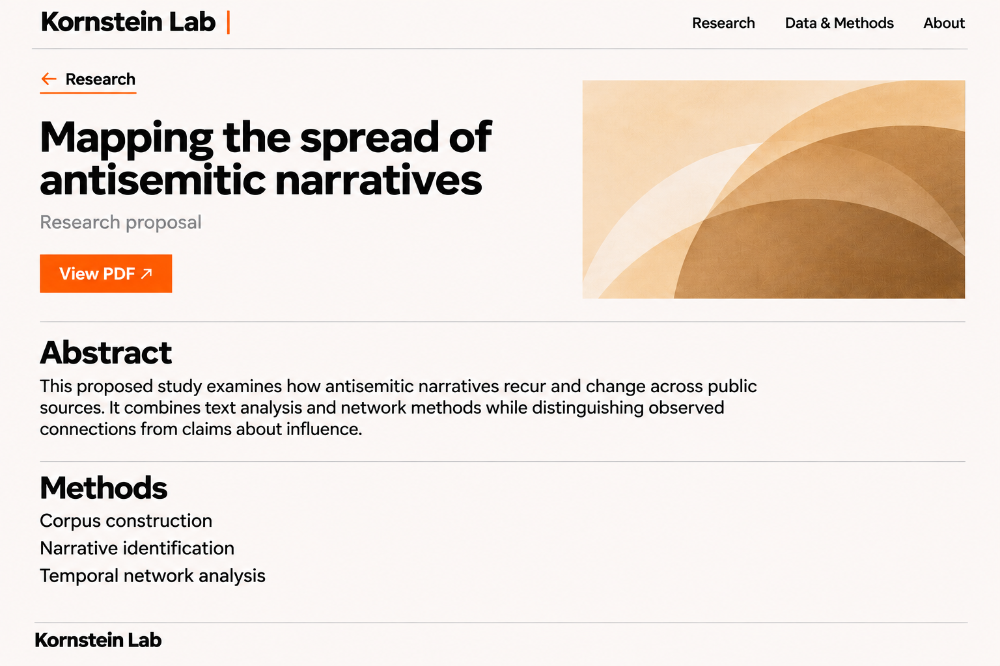
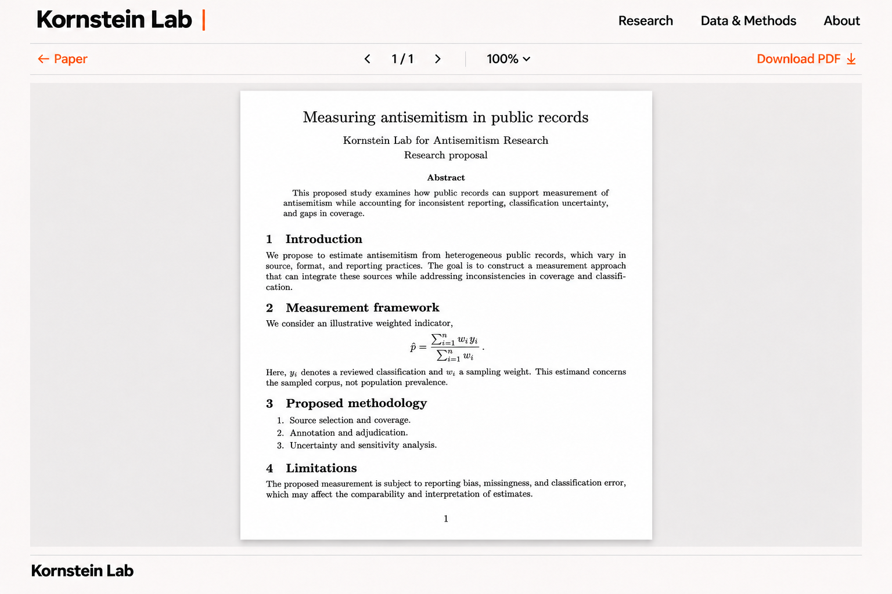

# Approved Kornstein Lab mockups

These are the eight unchanged approved references, each 1536 × 1024 pixels. Use them for browser comparison at that viewport size and device scale factor 1. Full implementation instructions are in [LOCAL_SESSION.md](../../LOCAL_SESSION.md).

The new research focus supersedes the older text visible in these pictures. Keep “Measuring antisemitism in online discourse,” “Evaluating algorithms for antisemitism detection,” and “Research corpora” in the implementation. Papers remain research proposals. Those authorized text changes are documented in the handoff; the visual design remains the reference.

## Homepage — `/`

## Research — `/research/`

## Data & Methods — `/methods/`

## About — `/about/`

## Measurement paper — `/research/measurement/`

## Detection paper — `/research/detection/`

## Narratives paper — `/research/narratives/`

## LaTeX reader — `/reader/?paper=measurement`

